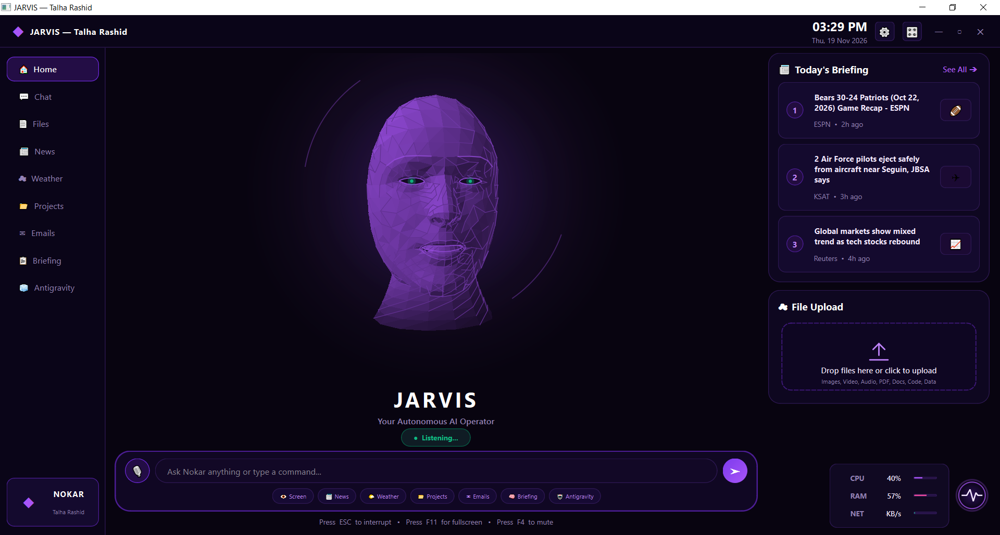
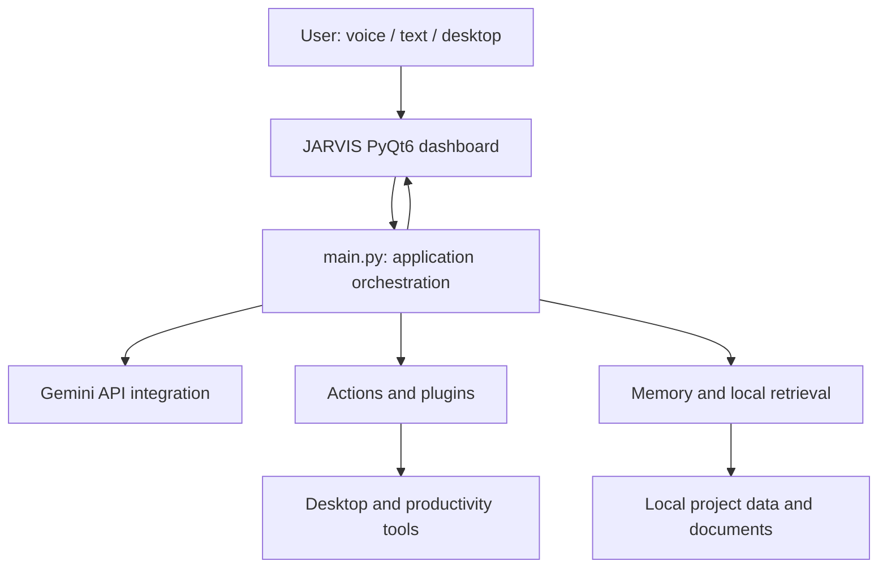

<div align="center">

# ◆ NOKAR
### Fully Autonomous AI Desktop Assistant

**Meet JARVIS — your intelligent desktop command center.**

*Speak naturally. Understand your screen. Organize your workflow. Take control of your desktop.*

[](https://www.python.org/)
[](https://pypi.org/project/PyQt6/)
[](https://ai.google.dev/)
[](#requirements)
[](LICENSE)

[**✨ Features**](#-features) · [**🖥️ Dashboard**](#️-meet-the-jarvis-dashboard) · [**🚀 Installation**](#-quick-start) · [**🧠 Architecture**](#-architecture) · [**👨‍💻 Developer**](#-meet-the-developer)



**The actual NOKAR / JARVIS dashboard — captured from the running Windows application.**

</div>

---

## 🌌 What is NOKAR?

**NOKAR** is a Python-powered desktop AI assistant with a visually rich **JARVIS dashboard**. It brings conversational AI, desktop tools, document workflows, and system information together in a single dark, futuristic workspace.

Instead of switching between different windows for everyday tasks, you can interact through a central chat-and-voice interface, explore dedicated sections, and use supported assistant actions from one place.

> **NOKAR** is the assistant project. **JARVIS** is the name displayed in the current dashboard interface.

## 🖥️ Meet the JARVIS Dashboard

The interface shown above uses a **midnight-black and electric-purple theme**, with a polygonal 3D avatar at the center and task-focused panels around it.

| Area | What you see |
|:--|:--|
| **3D AI avatar** | Animated, purple low-poly face with illuminated eyes |
| **Voice + chat** | Microphone control, command input, send button, and listening status |
| **Navigation sidebar** | Home, Chat, Files, News, Weather, Projects, Emails, Briefing, Antigravity |
| **Today's Briefing** | News cards and a shortcut to see more |
| **File Upload** | Drag-and-drop area for documents and other supported files |
| **Quick actions** | Shortcuts for screen, news, weather, projects, email, and more |
| **System monitor** | CPU, RAM, and network activity indicators |
| **Desktop HUD** | Fullscreen control, settings, live clock, and quick controls |

## ✨ Features

<table>
<tr><td width="50%" valign="top">

### 🎙️ Conversational AI
Voice-first interaction and typed prompts through the central command bar. The project integrates Google Gemini services for AI responses.

### 👁️ Screen Awareness
Screen-related commands and visual context features are available through the assistant's desktop toolset.

### 🧠 Local Memory & Retrieval
Project modules for long-term memory, local document indexing, and retrieval-augmented responses.

### 🗂️ Files & Productivity
Dedicated file, project, and task-oriented views, with desktop actions provided by the installed modules.

</td><td width="50%" valign="top">

### 📰 News & Briefings
A dedicated briefing panel plus navigation for news and daily information.

### 🌤️ Weather & Information
Weather and information shortcuts accessible from the sidebar and command bar.

### ⚙️ Desktop Automation
A modular action layer designed to interact with supported desktop applications and workflows.

### 📊 Live System Insights
At-a-glance CPU, RAM, and network indicators inside the dashboard.

</td></tr>
</table>

> **Feature availability:** Some functions depend on API configuration, operating-system permissions, internet access, optional integrations, or the installed version. The screenshot illustrates the current interface, not a guarantee that every integration is configured.

## 🧠 Architecture



### 🧰 Technology Stack

| Layer | Technologies |
|:--|:--|
| **Language** | Python |
| **Desktop UI** | PyQt6 / Qt |
| **AI services** | Google Gemini APIs |
| **Visual / audio modules** | OpenCV, NumPy, audio libraries (as required by features) |
| **Memory & retrieval** | Local Python memory and RAG modules |
| **Automation** | Python actions, plugins, OS integrations |
| **Development** | VS Code, Git, GitHub |

## 🚀 Quick Start

### Requirements

- **Windows 10/11** is the environment used for the dashboard shown here. Other platforms may require adaptation.
- A supported Python installation (Python **3.12** is a practical starting point).
- Git, an internet connection for cloud AI features, and a microphone for voice features.
- A Google Gemini API key for features that use Gemini.

### 1. Clone the project

```powershell
git clone https://github.com/talhareads/NOKAR-AI-Desktop-Assistant.git
cd NOKAR-AI-Desktop-Assistant
```

### 2. Create a virtual environment

```powershell
python -m venv .venv
.\.venv\Scripts\Activate.ps1
```

If PowerShell prevents activation, you can run the environment's Python executable directly in subsequent commands.

### 3. Install dependencies

```powershell
python -m pip install --upgrade pip
python -m pip install -r requirements.txt
```

The repository also includes `setup.py` for project-specific setup. Review it before running setup scripts.

### 4. Configure your credentials

Use `.env.example` and the example configuration files under `config/` as references. Add your own API credentials **locally** and follow the configuration documentation in [`docs/CONFIGURATION.md`](docs/CONFIGURATION.md), where applicable.

**Never commit real API keys, passwords, session tokens, or private memory files.**

### 5. Run NOKAR

```powershell
python main.py
```

On Windows, the project also includes a `start_nokar.bat` launcher.

## 📁 Project Overview

```text
NOKAR-AI-Desktop-Assistant/
├── actions/           # Desktop actions and integrations
├── assets/            # Images and UI resources
│   └── nokar_dashboard.png
├── config/            # Configuration templates and settings
├── core/              # Assistant core and prompt resources
├── dashboard/         # Dashboard-related modules
├── docs/              # Technical documentation
├── memory/            # Local memory and retrieval modules
├── plugins/           # Extensible assistant tools
├── tests/             # Test suite
├── main.py            # Application entry point
├── ui.py              # Desktop interface
├── requirements.txt   # Python dependencies
└── README.md
```

## 🔐 Privacy & Responsible Use

- Keep API keys, credentials, local memories, and private documents out of Git.
- Review commands before granting desktop automation permissions.
- Confirm potentially destructive actions and maintain backups of important files.
- Cloud AI requests may be processed by the relevant API provider; review its policies before submitting sensitive information.

## 🗺️ Roadmap

- [x] Personalized JARVIS dashboard and dark-purple visual identity
- [x] Centralized voice/chat command area
- [x] News briefing and system-monitoring panels
- [ ] Expand dashboard customization and themes
- [ ] Improve cross-platform compatibility and testing
- [ ] Add more documented automation examples
- [ ] Expand end-to-end tests and setup guides

## 📚 Documentation

[Architecture](docs/ARCHITECTURE.md) · [Configuration](docs/CONFIGURATION.md) · [Tools](docs/TOOLS.md) · [Contributing](CONTRIBUTING.md) · [Security](SECURITY.md) · [Changelog](CHANGELOG.md)

## 👨‍💻 Meet the Developer

<div align="center">


### Talha Rashid

**BS Artificial Intelligence Student · Python Developer · AI & Machine Learning Enthusiast**

*Building practical AI experiences, one project at a time.*

[](https://github.com/talhareads)
[](https://www.linkedin.com/in/talha-rashid-706b39345/)
[](mailto:talharashid8605@gmail.com)

**Project repository:** [github.com/talhareads/NOKAR-AI-Desktop-Assistant](https://github.com/talhareads/NOKAR-AI-Desktop-Assistant)

</div>

## 📜 License & Third-Party Notices

See [`LICENSE`](LICENSE) for the project's license text and copyright notices. The repository includes components and assets that may have separate third-party licensing requirements, including the MediaPipe-derived face model described in the license notice.

**Rights note:** Where code is derived from a prior version, redistribution and attribution depend on the original license and any valid written transfer or separate permission. Repository ownership alone does not transfer third-party copyrights.

---

<div align="center">

### ◆ NOKAR · JARVIS Dashboard

**Designed for a smarter desktop experience.**

Made with 💜 by **Talha Rashid** · [⭐ Star this repository](https://github.com/talhareads/NOKAR-AI-Desktop-Assistant)

</div>
